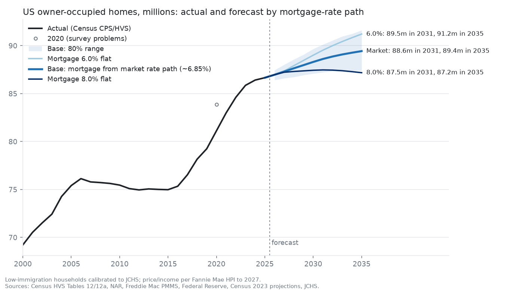

# US owner-occupied homes forecast, 2026-2035

A forecast of the number of owner-occupied homes in the United States, by age of householder, built from
two pieces:

1. **A cohort-flow model of homeownership by age** ([methodology](docs/methodology-owner-occupied-homes.md)).
   Owner-occupied homes = households by age x ownership rate by age, summed over twelve age bands. Ageing is
   taken out of the ownership rate first; what is left, the net flow into ownership inside each cohort, is
   regressed on last year's house prices relative to income, the mortgage-rate payment burden and mortgage
   delinquency (panel OLS, 1992-2025, 352 band-years, adjusted R² 0.793).
2. **A market-implied path for the 30-year mortgage rate** ([methodology](docs/methodology-rate-path.md)).
   Expected one-year rates from the Federal Reserve Board's Kim-Wright term-structure model are compounded
   into 30-year and 10-year Treasury paths, plus a maturity premium backed out of today's yields, plus the
   median spread between the Freddie Mac mortgage rate and the 30-year Treasury.

Data vintage: market data as of 28-Sep-2026 (Kim-Wright fit of 25-Sep-2026, Freddie Mac PMMS to
24-Sep-2026); Census housing data through 2025. Everything in this repository reproduces from the raw files in
`data/raw/`.



## Results

| Scenario (millions of owner-occupied homes) | 2025 | 2026 | 2031 | 2035 | k a year 2025-31 |
|---|---|---|---|---|---|
| **Base: mortgage rate from the market path (~6.85%)** | **86.66** | **86.97** | **88.62** | **89.44** | **+326** |
| Mortgage rate from the FOMC dots path (~6.8%) | 86.66 | 86.97 | 88.65 | 89.53 | +332 |
| Mortgage 6.0% flat | 86.66 | 86.97 | 89.53 | 91.22 | +479 |
| Mortgage 7.0% flat | 86.66 | 86.97 | 88.47 | 89.14 | +302 |
| Mortgage 8.0% flat | 86.66 | 86.97 | 87.47 | 87.18 | +135 |
| Base, price/income stays at its 2025 level | 86.66 | 86.97 | 87.69 | 87.65 | +172 |
| Base, JCHS main-immigration households | 86.66 | 87.06 | 89.18 | 90.40 | +420 |
| Base, zero-immigration households | 86.66 | 86.77 | 87.38 | 87.35 | +120 |
| Ownership rates by age frozen at 2025 (no model) | 86.66 | 87.38 | 90.44 | 92.32 | +630 |

- **Base case:** 86.66m (2025) to 88.62m (2031) and 89.44m (2035). The national ownership rate drifts from
  65.3% to 64.5% (2031) and 64.0% (2035).
- **80% range around the base, 2031:** 87.2m to 90.1m (coefficient uncertainty plus historical year shocks).
- **Rates matter, with a lag:** each 1pp on the mortgage rate moves 2031 by about 1.0m and 2035 by about 2.0m.
  Nothing happens in 2026, because the model reads last year's conditions.
- **Two other assumptions matter as much as rates:** immigration, and whether house prices keep easing relative
  to income.
- **All of the net growth is in the 75+ group** (+3.5m owners by 2031). Owners under 75 fall by 1.5m by 2031 and
  by 2.9m by 2035.
- **Known bias:** the model has no mortgage lock-in term. Estimated to 2021 and fed actual 2022-25 conditions, it
  ended 1.5pp too low on the national rate in 2025. Its near-term path for ages 35-54 is more likely too low
  than too high.

Every scenario, year and age group: [docs/results.md](docs/results.md) and
`outputs/Owner_Occupied_Forecast.xlsx`.

## Run it

Python 3.10 or later.

```
pip install -r requirements.txt
python run_all.py
```

`run_all.py` runs the five steps in order (about 2-3 minutes; the uncertainty band is 2,000 simulations):

| Step | Script | Reads | Writes |
|---|---|---|---|
| 1 | `src/tenure_data.py` | Census HVS tables, NAR affordability (via HUD), FRED, Census projections, FHFA NMDB | `data/processed/tenure_*.csv`, `affordability_annual.csv`, `population_by_age_proj.csv`, `nmdb_annual.csv` |
| 2 | `src/mortgage_path.py` | FRED Treasury yields, Kim-Wright, fed funds, PMMS | `data/processed/mortgage_rate_path*.csv`, `kim_wright_expected_rates.csv` |
| 3 | `src/tenure_model.py` | step 1 and 2 outputs | coefficients, diagnostics, backtest, forecast, uncertainty band (`data/processed/`) |
| 4 | `src/tenure_chart.py` | step 3 outputs | `outputs/owner_occupied_forecast.png` |
| 5 | `src/build_forecast_workbook.py` | step 3 outputs | `outputs/Owner_Occupied_Forecast.xlsx` |

The console output of steps 2 and 3 is kept in `data/processed/mortgage_path_run.log` and
`data/processed/model_run.log`; every number in the docs can be found there or in the CSVs next to them.

## Repository layout

| Folder | Contents |
|---|---|
| `data/raw/` | Inputs exactly as downloaded (sources: `docs/data-sources.md`) |
| `data/processed/` | Every intermediate and output table, plus the run logs |
| `src/` | The five scripts |
| `outputs/` | Chart and Excel workbook |
| `docs/` | Methodology (homes model, rate path), results, data sources |

## Documentation

- [Owner-occupied homes model: methodology and diagnostics](docs/methodology-owner-occupied-homes.md)
- [Treasury and mortgage rate path: methodology](docs/methodology-rate-path.md)
- [Results: every scenario, by year and age group](docs/results.md)
- [Data sources](docs/data-sources.md)

## License

Code: MIT (see `LICENSE`). The files in `data/raw/` belong to their publishers (US Census Bureau, Federal
Reserve Board, Federal Reserve Bank of St. Louis, Freddie Mac, FHFA, HUD / National Association of Realtors)
and are included only so the results can be reproduced; see `docs/data-sources.md`.
